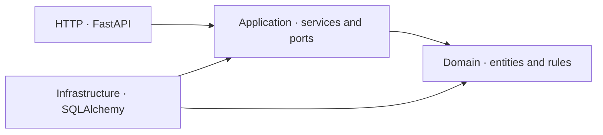

# Maitre API

The **Maitre API** is the backend for **Maitre**, an order management system designed for restaurants, coffee shops, snack bars, and other food-service businesses.

> 🚧 **Work in Progress (WIP)**
> 
> This project is still in development. Features and implementation details may change as development progresses.

## What is Maitre?

The name **Maitre** is inspired by the French term [*maître d'hôtel*][maitre-d], which refers to the person in charge of a restaurant.

The project was inspired by [Restaurante UAI][uai], my family's 35-year-old business in the heart of Minas Gerais, where I grew up, worked, and faced many day-to-day challenges. I wanted to draw on these experiences and my knowledge to build a solution that could make order workflows simpler and more efficient.

## Features

- Manage tables;
- Manage products;
- Create orders;
- Add products to clients' orders;
- Finish orders;
- Automatically update table states.


## Tech stack

The project uses the following technologies to build a backend application.

- Python - Programming language;
- PostgreSQL - Database;
- uv - Dependency and project management;
- Alembic - Database migrations;
- FastAPI - API framework;
- Pydantic - Data validation and settings;
- Pytest - Testing framework.

## Getting Started

### Prerequisites

- [Python 3.13 or higher][python];
- [uv][uv];
- [PostgreSQL 17][postgresql] or [Docker][docker];

### Installation

From the repository root, install the project dependencies with uv:

```bash
uv sync
```

This creates the project environment and installs the application and development dependencies.

### Environment Configuration

Create a local `.env` file from the example:

```bash
cp .env.example .env
```

Set `POSTGRES_DB`, `POSTGRES_USER`, and `POSTGRES_PASSWORD` to the database name and credentials you want to use. Set `POSTGRES_HOST` and `POSTGRES_PORT` to the host and port where PostgreSQL is reachable. The example values are intended for local development.

### Database Setup and Migrations

Start PostgreSQL 17 locally, or start the repository's PostgreSQL container:

```bash
docker compose up -d postgres
```

The Compose service reads the database name, user, and password from `.env` and exposes PostgreSQL on port `5432`. If you use a local PostgreSQL installation instead, make sure its database and credentials match `.env`.

Apply the database migrations:

```bash
uv run alembic upgrade head
```

### Running the Application

Start the development server from the repository root:

```bash
uv run uvicorn maitre_api.main:app --reload --host 127.0.0.1 --port 8000
```

The API is available at [http://127.0.0.1:8000](http://127.0.0.1:8000).

### Running Tests

Run the test suite from the repository root:

```bash
uv run pytest
```

Pytest also reports code coverage and enforces the project's 90% coverage threshold. Make sure the `.env` file is configured before running the tests. Docker must be running: the integration tests use Testcontainers to start an isolated PostgreSQL 17 instance and apply the Alembic migrations. They cover the HTTP order lifecycle, transaction rollback, database constraints, and concurrent order creation.

## API Documentation

### Swagger

The Swagger API documentation is available at `http://127.0.0.1:8000/docs`.

### Bruno

[Bruno][bruno] is a Git-friendly, open-source API client that makes it easier to manage, version, and share API collections using Git.

This project's API reference, created using Bruno, is available in the [maitre-api-reference][api-ref] repository.

## Architecture

The API separates HTTP delivery, use-case coordination, business rules, and persistence:



Arrows show dependency direction. Services use repository ports; infrastructure implements them. Dependency providers connect the concrete adapters to the services.

- **Domain:** entities and state transitions, independent of HTTP and the ORM.
- **Application:** coordinates operations and transactions.
- **Infrastructure:** persists data and maps database models to domain entities.
- **HTTP:** validates requests, serializes responses, and translates business errors.

See [three technical decisions behind the design](docs/architecture.md): ORM decoupling, atomic transactions, and concurrency control.

## Roadmap

1. Stabilization and architectural improvements;
2. QA automation and CI/CD pipeline implementation;
3. New features:
    - User registration and authentication;
    - Role-based access control (RBAC);
    - Multi-tenant support.
4. Web application development and production deployment.


[uai]: https://www.google.com/maps/place/Restaurante+Uai/@-19.9595986,-43.4148184,17z/data=!3m1!4b1!4m6!3m5!1s0xa44929e6f0ab8f:0x267ed0df4d2c0dbc!8m2!3d-19.9595986!4d-43.4148184!16s%2Fg%2F1yfjhdm8k?entry=ttu&g_ep=EgoyMDI2MTAxMy4wIKXMDSoASAFQAw%3D%3D
[api-ref]: https://github.com/ffvasconcelos/maitre-api-reference
[maitre-d]: https://dictionary.cambridge.org/dictionary/english/maitre-d
[python]: https://www.python.org/downloads/
[uv]: https://docs.astral.sh/uv/getting-started/installation/
[postgresql]: https://www.postgresql.org/download/
[docker]: https://docs.docker.com/get-started/get-docker/
[bruno]: https://www.usebruno.com/
